{width=30%}

# Introduction

Untargeted metabolomics studies by mass spectrometry technologies generate huge numbers of metabolite signals, requiring computational analyses for post-acquisition processing and dedicated databases for metabolite identification. Web-based data processing solutions frequently include only a part of the entire workflow thus implying the use of different platforms. The R package margheRita addresses the complete workflow for metabolomic profiling in untargeted studies based on liquid chromatography (LC) coupled with tandem mass spectrometry (MS/MS). This pipeline is specially advantageous in the case of data-independent acquisition (DIA), where all MS/MS spectra are acquired with high resolution. Interestingly, the R package margheRita enhances fragment matching accuracy by providing an original metabolite spectral library acquired in both polarities using different chromatographic columns.

The package provides:

- a series of pre-processing functions (quality control, filtering and normalization) with a particular focus on methods specifically recommended for metabolomic profiles, such as filtering by mass defects, filtering by coefficient of variation (samples vs QCs) and probabilistic quotient normalization;
- metabolite annotation up to level-1, based on in-house spectral libraries as well as freely available libraries;
- spectral libraries that covers 4 different chromatographic column types: RP-C18, HILIC, RP-C8 and pZIC-HILIC Zwitterionic.
- simplified execution of parametric and non-parametric statistical tests over a large number of features;
- pathway analysis based on ORA and MSEA over various databases.

Source code: https://github.com/emosca-cnr/margheRita

Citation:  Ettore Mosca, Marynka Ulaszewska, Zahrasadat Alavikakhki, Edoardo Niccolò Bellini, Valeria Mannella, Gianfranco Frigerio, Denise Drago, Annapaola Andolfo. MargheRita: an R package for LC-MS/MS SWATH metabolomics data analysis and confident metabolite identification based on a spectral library of reference standards. bioRxiv 2024.06.20.599545; doi: https://doi.org/10.1101/2024.06.20.599545


Contacts:

- [Annapaola Andolfo](https://research.hsr.it/en/core-facilities/promefa/annapaola-andolfo.html), Proteomics and Metabolomics Facility, HSR
- [Ettore Mosca](https://www.itb.cnr.it/en/institute/staff/ettore-mosca), Bioinformatics Lab, CNR-ITB

# Installation

The package has the following dependencies,which are available in [CRAN](https://cran.r-project.org/), [Bioconductor](https://www.bioconductor.org/) or [github](https://github.com/), namely:

```{r, eval=FALSE}
ComplexHeatmap, circlize, clusterProfiler, GGally, ggrepel, ggplot2, ggpubr, LSD, MsBackendMsp, openxlsx, pals, pcaMethods, reshape2, rlang, Spectra, stats, stringr, SummarizedExperiment, utils
```

In most of the cases, the following instructions guarantee that all such dependencies are installed:

```{r, eval=FALSE}
install.packages("devtools")

if (!require("BiocManager", quietly = TRUE)){
  install.packages("BiocManager")
}
BiocManager::install(c("Biobase", "ComplexHeatmap", "clusterProfiler", "pcaMethods"))

devtools::install_github("emosca-cnr/margheRita")
```

# Input data

margheRita is intended to be used after having done a number of data acquisition steps through MS-Dial [@Tsugawa2015]. It requires two text files in tab-delimited format:

- **feature data file**, which must include feature identifiers, m/z values, retention times, MS/MS spectra and feature abundances across samples; usually, this file is generated by MS-Dial;
- **sample annotation file**, which must include the following mandatory columns: "id", "injection_order", "batch", "class", "biological_rep" and "technical_rep"; quality control samples must be labelled "QC" in the column "class".

A couple of **remarks**:
 
- short sample ids yield better figures;

- the collapse of technical replicates (see below) takes place over all samples that share the same concatenation of "class" and "biological_rep" values.

Here we demonstrate the use of margheRita using the "Urine" dataset, files "Urine_RP_POS_norm.txt" and "Urine_RP_POS_sample_annotation.txt", available in [Zenodo](https://doi.org/10.5281/zenodo.11243780).

The function `read_input_file()` reads the two files and creates the object of class "mRList", which is used by most of margheRita functions as main input/output. 

```{r, eval=FALSE}
mL <- read_input_file(feature_file = "Urine_RP_POS_norm.txt", sample_file = "Urine_RP_POS_sample_annotation.txt")
Reading MS-Dial input file...
[1] 33554   316
Reading sample annotation
# Samples: 316 
# QC Samples: 61
class(mL)
[1] "mRList"
table(mL$sample_ann$class)

    AA  Blank     DD     MM meal A meal B meal C 
    81      3     81     81      3      3      3 
```

The initial object contains the following elements
```{r, eval=FALSE}
names(mL)
[1] "data"       "metab_ann"  "sample_ann" "QC"         "QC_ann"
```
which are:

- data: features-by-samples matrix containing metabolite abundances;

- metab_ann: metabolite annotation;

- sample_ann: sample annotation;

- QC: features-by-samples matrix containing metabolite abundances of QC samples;

- QC_ann: annotation of QC samples.

# Filtering

The function **`filtering()`** runs filters to exclude features/sample with many missing values, features with wrong m/z values and, lastly, performs imputation of missing values. These three steps can be called independently through the function `filter_NA()`, `m_z_filtering()` and `imputation()`, respectively. In particular, `m_z_filtering()` remove features with m/z that have decimal value within [4, 8] (by default), while the imputation is performed replacing NA values with a random number, calculated between 10%-25% of the minimum value of the feature. 

Before filtering we can take a loog at the distributions of m/z decimal values and m/z vs rt using:

```{r, eval=FALSE}
plot_mz_decs(mL)
heatscatter_chromatography(mL)
```
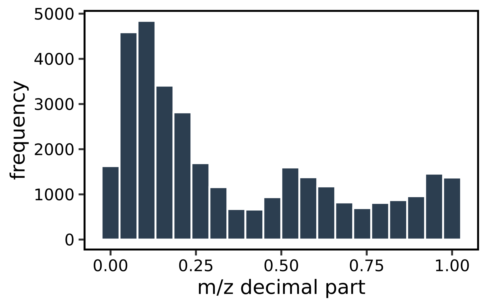{width=49%} 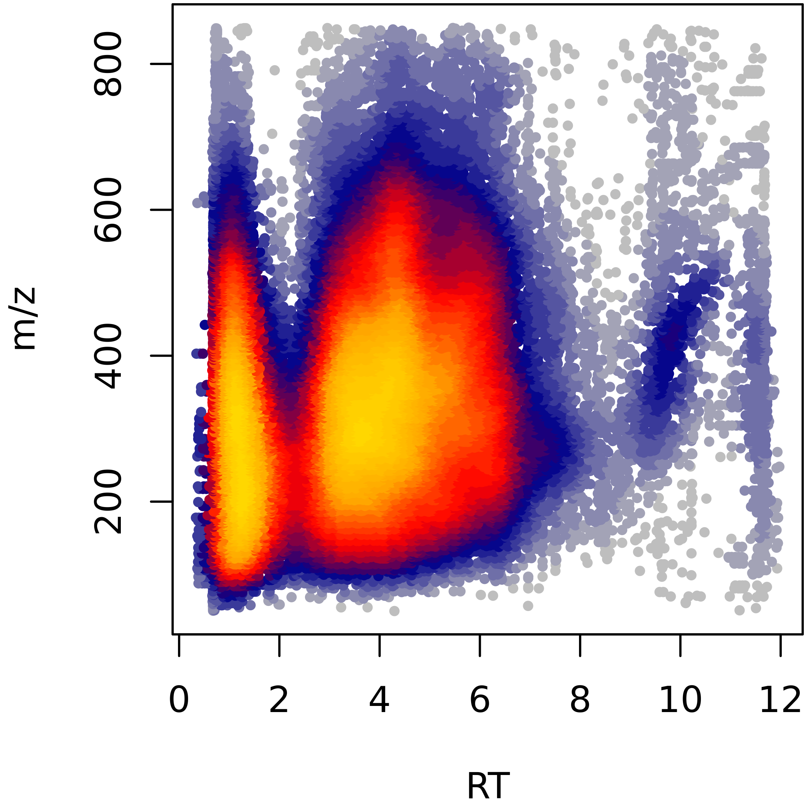{width=49%}


```{r, eval=FALSE}
mL <- filtering(mL)
# Samples with >= 100 metabolites 255 / 255 
# Features occurring in >=  3 samples 33554 / 33554 
# Features with appropriate m/z values: 25786 
# Features without appropriate m/z values: 7768 
No NAs: imputation not performed.
```


It is useful to look at the distributions of m/z decimals and m/z vs rt after filtering.

```{r, eval=FALSE}
plot_mz_decs(mL.id)
heatscatter_chromatography(mL)
```

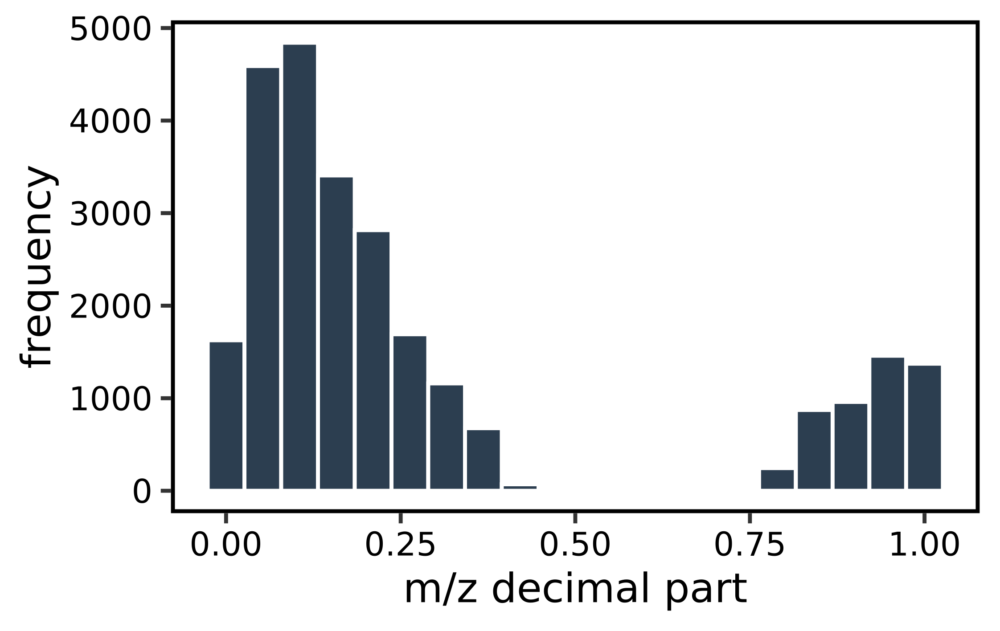{width=49%} 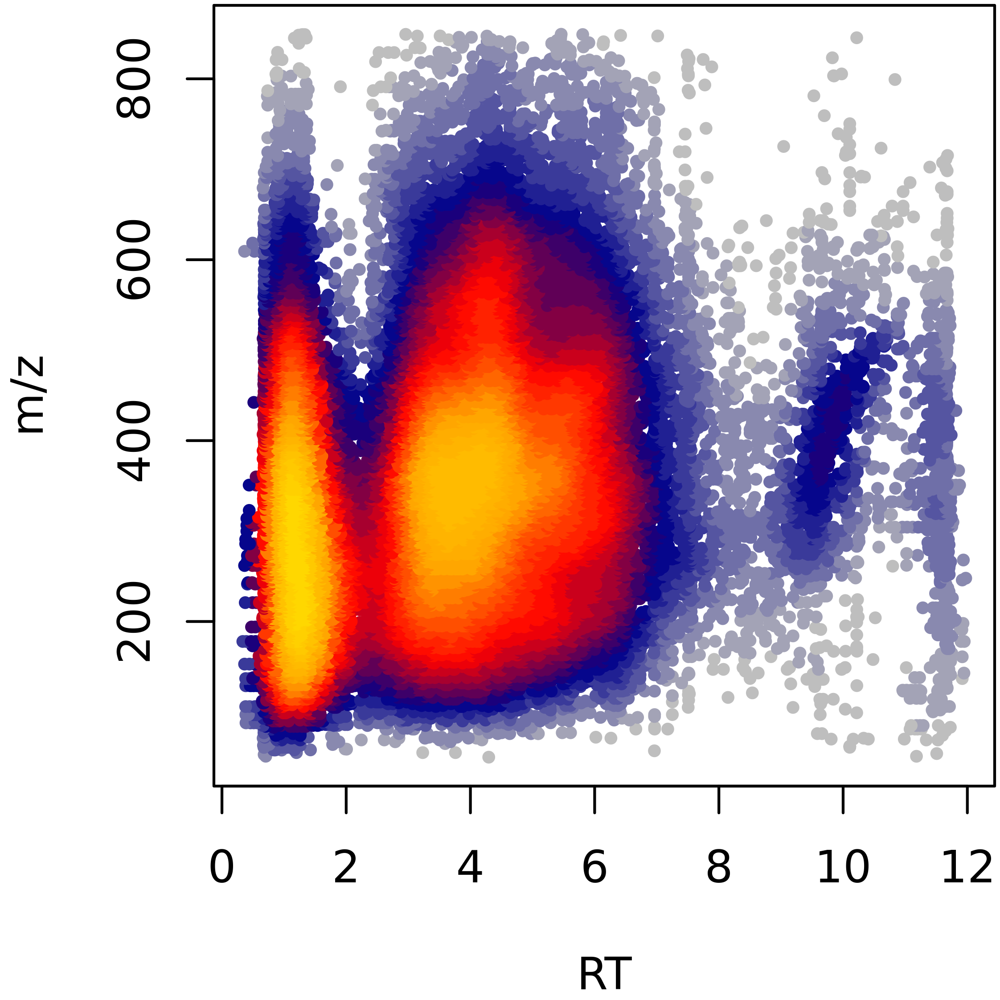{width=49%}

# Removing samples

The function `remove_samples()` allows the user to remove one or more samples from the `mRList`. Here, we remove samples that have values "Blank", "meal A", "meal B", "meal C" in the column "class":

```{r, eval=FALSE}
mL <- remove_samples(mRList = mL, ids = c("Blank", "meal A", "meal B", "meal C"), column = "class")
removing x001_Blank_1_norm_RP_short_SWATH_pos x002_Blank_1_norm_RP_short_SWATH_pos x003_Blank_1_norm_RP_short_SWATH_pos x306_BananaShake_norm_rtech1_RP_short_SWATH_pos x307_PapayaShake_norm_rtech1_RP_short_SWATH_pos x308_KefirShake_norm_rtech1_RP_short_SWATH_pos x310_KefirShake_norm_rtech2_RP_short_SWATH_pos x311_PapayaShake_norm_rtech2_RP_short_SWATH_pos x312_BananaShake_norm_rtech2_RP_short_SWATH_pos x314_PapayaShake_norm_rtech3_RP_short_SWATH_pos x315_BananaShake_norm_rtech3_RP_short_SWATH_pos x316_KefirShake_norm_rtech3_RP_short_SWATH_pos
table(mL$sample_ann$class)
AA DD MM 
81 81 81 
```

# Normalizaiton

margheRita provides three ways for **normalizing** metabolite profiles: 

- "log", the log2 of metabolite abundances;
- "reference", every sample is divided by a reference value;
- "pqn", probabilistic quotient normalization [@Dieterle2006]; 

For "reference" and "pqn" methods, the column `reference` must be present in `mRList$metab_ann`. If missing, the function `calc_reference()` sets up such column using average metabolite values and medians of QC samples. For example, here's a call to `normalize_profiles()` using pqn:
```{r, eval=FALSE}
mL.norm <- normalize_profiles(mL, method = "pqn")
PQN normalization
No reference profile found, using calc_reference() function...
Using QC...
```

The comparison of the coefficient of variation of a metabolite in relation to QC samples provides a means to exclude low quality features. In particular, only features that have a CV ratio between no-QC samples and QC sample higher than a given threshold (by default 1) are kept:

```{r, eval=FALSE}
CV_ratio(mRList = mL.norm, dirout = dir_out)
Summary of CV ratio (samples / QC):
   Min. 1st Qu.  Median    Mean 3rd Qu.    Max. 
 0.1633  1.3511  2.0665  2.9914  3.7041 36.8086 
# Features with appropriate CV 23313 / 25786 
```

Typically, after normalization, the various samples should have similar distributions of relative log-*abundance*, a powerful tool to visualize unwanted variation in high-dimensional data [@Gandolfo2017]. 

```{r, eval=FALSE}
mL.id <- RLA(mL.id, logged = F)
p <- plot_RLA(mL.id)
```

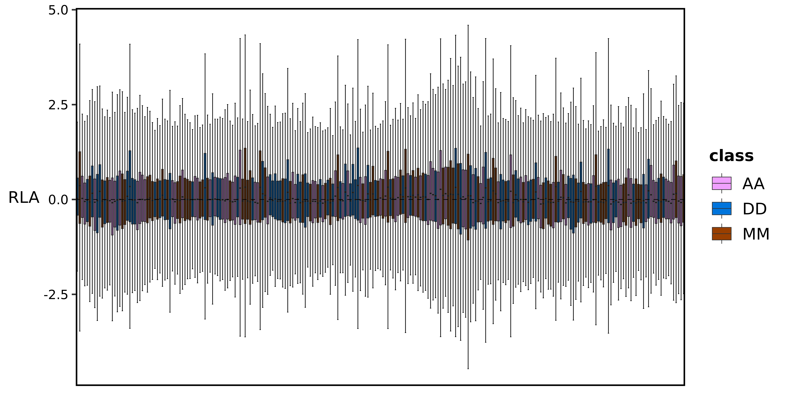{width=100%}


# Principal Component Analysis 

margheRita performs Principal Component Analysis (PCA) using the function `mR_pca()`, which relies on the package pcaMethods [@Stacklies2007]. Besides choosing the scaling method (argument `scaling`) and number of PCs (`nPcS`), it allows to include/exclude quality control samples by means of argument `include_QC`:

```{r , eval=F}
mL_norm <- mR_pca(mRList = mL_norm, nPcs=5, scaling="uv", include_QC=FALSE)
```
The results are added to the mRList in the element `pca`. The function `plot_PCA_res()` produces a list of two ggplot2 objects, namely `pairs` and `scree`, which contain scatter plots among all-pairs of PCs and the variance explained by the PCs; similarly,  the function `Plot2DPCA()` generate the scatter plots for the scores and loadings (not shown below). The column `col_by` indicates which column of sample annotation is used to color the samples.

```{r , eval=F}
p <- plot_PCA_res(mRList = mL.id, col_by="subj_meal")
Using default palette
names(p)
[1] "scree" "pairs"
Plot2DPCA(mRList = mL.id, pcx=1, pcy=2, col_by="subj_meal")
Using default palette
> names(p)
[1] "scores"   "loadings"
```
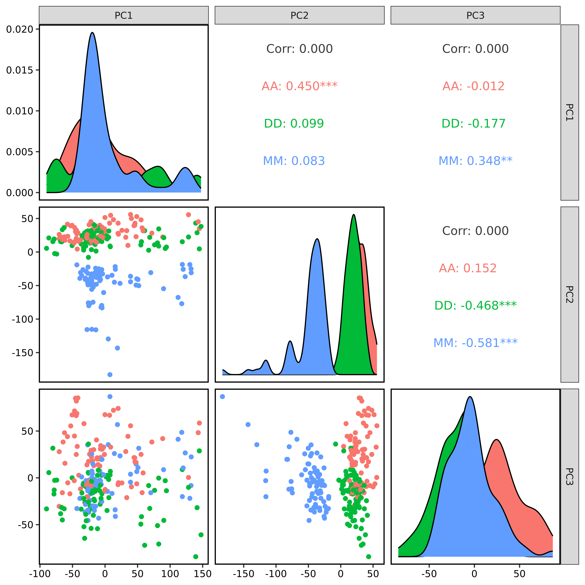{width=100%}
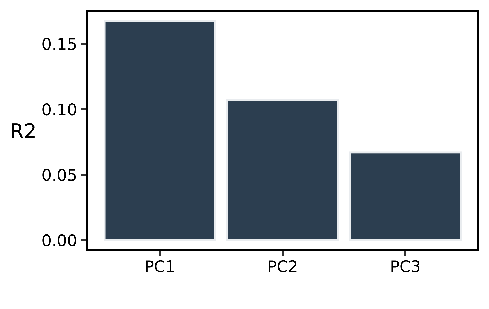{width=49%}
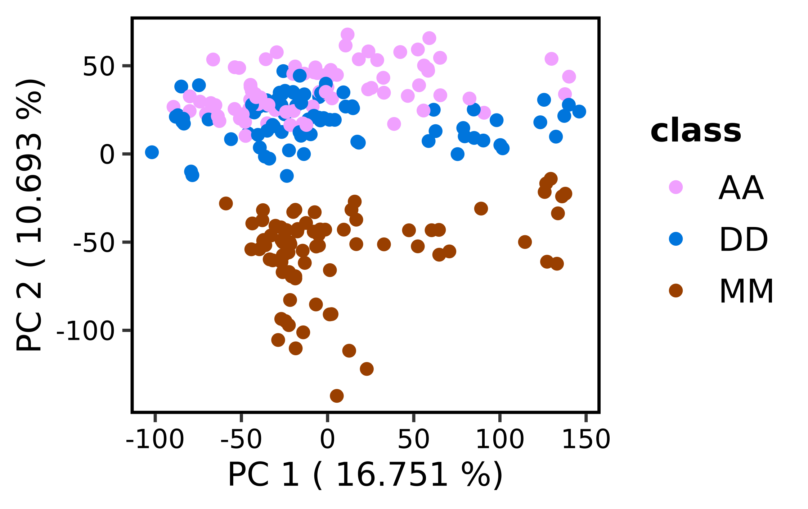{width=49%}


# Collapsing techinical replicates

The definition of mean metabolite abundance for every biological replicate is performed by means of `collapse_tech_rep()` function:

```{r, eval=FALSE}
mL.norm.bio <- collapse_tech_rep(mL.norm)
According to dataset size, this might take a few minutes.
```

# Statistical analysis

MargheRita provides some functions to calculate mean and variability, fold changes and to test for metabolite variations.

The function `mean_median_stdev_samples()` calculates mean, median and standard deviation of metabolite abundance according to the sample classes specified in the column "class" of sample annotation:

```{r, eval=FALSE}
mean_median_stdev_samples(mL.norm.bio)
According to dataset size, this might take a few minutes.
Calculating means...
Calculating medians...
Calculating standard deviations...
```

The function `univariate()` performs dataset-wide statistical tests (Student t-tests, Wilcoxon test, Anova and Kruskal-Wallis test) between levels of a particular factor defined in the sample annotation:

```{r, eval=FALSE}
mL.norm.bio <- univariate(mL.norm.bio, test_method="anova", exp.levels = c("AA", "DD", "MM"), exp.factor = "class")
exp.levels:  AA DD MM 
exp.factor:  class 
selected samples:
             id level
1  AA_mealA_t00    AA
2  AA_mealA_t01    AA
3  AA_mealA_t02    AA
4  AA_mealA_t03    AA
...
81 MM_mealC_t08    MM
Performing ANOVA between AA DD MM 
head(mL.norm.bio$anova)
              F            p            q      DD-AA        MM-AA       MM-DD
F6    0.8784645 4.194894e-01 4.986295e-01 0.40015792 9.074457e-01 0.655270262
F7   78.0339455 2.439819e-19 1.990054e-17 0.26024644 0.000000e+00 0.000000000
F38   2.1888987 1.188756e-01 1.739468e-01 0.10414045 3.829524e-01 0.744258367
F60   0.5589524 5.740810e-01 6.422382e-01 0.96640783 5.700494e-01 0.725243155
F64   9.1681931 2.653785e-04 9.536909e-04 0.02069160 1.914172e-04 0.304841472
F128 15.7198757 1.835949e-06 1.149525e-05 0.09927893 1.127459e-06 0.002473063
```

The full results of the analysis are saved to the text file <test_method>.txt.

We found it helpful to provide a function for retrieving the list of significant features:

```{r, eval=FALSE}
significant_features <- select_sign_features(mL.norm.bio, test_method="anova", test_value = "q", cutoff_value = 0.05, feature_id = "Feature_ID")
```


By default the function provides the Feature_ID. After having performed metabolite annotation, it is also possible to retrieve "Name" and "PubChemCID" (see below).

# Metabolite identification

Metabolite identification in margheRita is performed by means of the function `metabolite_identification()`, which requires an mRList object and a reference library with MS and MS/MS metabolite information. The identification is possible up to level-1, provided that the required information are available in the reference library. The identification is based on the quantification of the following quantities:

- retention time (RT) error: $$\epsilon_{rt}(i,j) = |t(i) - t(j)|$$
- ppm error: $$\epsilon_{m/z}(i,j) = \frac{|x(i) - x(j)|}{x(j)} \cdot 10^6$$
- percent relative intensity error: $$\epsilon_{I}(i,j) = \frac{|I(i) - I(j)|}{I(j)} \cdot 100$$

Such quantities are used to score the similarity among precursors of features and metabolites, as well as their MS/MS peaks.

## Spectral library

The function `select_library()` provides a means to select any of two sources:

- **margheRita**, which contains MS and MS/MS information for about 800 metabolites spanning several biological functions; these libraries provideup to level 1 identifications in positive and negative modalities for "HILIC", "LipC8", "pZIC", "RPLong" and "RPShort" chromatographic columns, that are acquired following the methods reported in the supplementary material of @Mosca2024.

- **MS-Dial**, which covers a much larger set of metabolites ($10^5$), but is limited to level 2 identifications in positive and negative modalities.

We illustrate this data structure selecting the margheRita library in positive modality with retention times of RPShort columns (using only peaks with relative intensity of at least 10 percent of the most intense peak, argument `accept_RI=10`).

```{r, eval=FALSE}
mR_library <- select_library(column = "RPShort", mode = "POS", accept_RI=10)
Library source: margheRita 
Column: RPShort 
mode:  POS 
minimum RI:  10 
# metabolites:  465
```
The resulting `mR_library` is a list that contains 4 elements. 

```{r, eval=FALSE}
names(mR_library)
[1] "lib_precursor"  "lib_peaks"      "lib_peaks_data" "key_field"
```
The first, `lib_precursor` is a data.frame that provides information at metabolite level (we do not show here the 7th column, `SMILES`, to simplify the output)
```{r, eval=FALSE}
head(mR_library$lib_precursor[, 1:6])
     ID      CAS                         Name   rt        mz PubChemCID
L10 L10 485-80-3 S-(5'-Adenosyl)-L-methionine 0.80 399.14452      34756
L14 L14  61-19-8      Adenosine monophosphate 1.40 348.07037       6083
L17 L17 979-92-0       S-Adenosylhomocysteine 1.28 385.12887     439155
L20 L20  56-86-0              L-Glutamic acid 0.90 148.06044      33032
L30 L30  56-40-6                      Glycine 0.85  76.03931        750
L33 L33  56-41-7                    L-Alanine 0.88  90.05496       5950
```
The element `lib_peaks_data` is a data.frame that list information for the MS/MS spectra
```{r, eval=FALSE}
head(mR_library$lib_peaks_data)
    ID        CAS Polarity                                      Name
1   M1   951-78-0      POS                           2'-Deoxyuridine
2   M2 25518-54-1      POS                       Lauroyl-L-carnitine
3   M3   542-32-5      POS                        2-Aminoadipic acid
6   M6 33818-15-4      POS Cytidine 5'-diphosphocholine (Citicoline)
7   M7  3604-79-3      POS                           3-Nitrotyrosine
12 M12   110-15-6      POS                             Succinic acid
```

The element `lib_peaks` is a named list with of spectra, where the first column is m/z while the second is the relative intensity; here we show the first element, M1:

```{r, eval=FALSE}
head(mR_library$lib_peaks$M1)
          [,1]      [,2]
[1,]  45.03236  10.34602
[2,]  70.02762  12.46120
[3,]  96.00721  13.50730
[4,]  99.04249  17.68019
[5,] 113.03337 100.00000
[6,] 117.05313  20.43913
```
### Are other libraries supported?

The function `library_from_msp()` provides a means to import library encoded as msp files in margheRita, generating the same data structure generated by `select_library()`:

```{r, eval=FALSE}
mR_library_external <- library_from_msp("MSMS-Public-Neg-VS15.msp")
names(mR_library_external)
[1] "lib_precursor"  "lib_peaks_data" "lib_peaks"      "key_field"
```

Otherwise you must encode you library in the same data structure generated by `select_library()`.

## Identification

Once the library is selected, metabolite identification can be performed by the homonymous function, where the argument `features` specifies the features to be considered (all features if it is left `features=NULL`, as in the following example):
```{r, eval=FALSE}
mL.norm.bio <- metabolite_identification(mL.norm.bio, library_list = mR_library)
# Features considered:  18026 
Checking RT... done
Checking precursor mz... done
Integrating RT and mz results... done
Assembling output for precursors...done
MS/MS analysis...
	# library metabolites to consider:  337 
	 100 / 337 
	 200 / 337 
	 300 / 337 
done
Assembling final output... Initial associations: 1245 
1) Filtering redundant MS/MS spectra for the same metabolite-feature...
	by highest number of peaks
	by highest peaks ratio...1011 
2) 1:n associations between metabolites and features...
	by highest peaks ratio
	by best annotaiton level
	by lowest ppm error...913 
3) 1:n associations between metabolites and features, not supported by MS/MS...
	by level... 479 
	by mass (category)... 380 
	by RT (category)... 	by RT... 372 
	by ppm... 368 
	by ppm... 366
	...
Adding annotations to metab_ann...
Adding annotations to data_ann...
Saving excel file metabolite_identification.xlsx...
done
```
The function `metabolite_identification()` has a series of parameters that can be adjusted to optimize the identification process (see its documentation). When metabolite identification is applied on a large number of features (e.g., $10^4$), it is common to obtain many-to-many associations between features and metabolite. By default, this redundancy is addressed following an algorithm that considers the classification (Level 1, Level 2, Level 3a and Level 3b), the errors (see above) and a series of quantitative and qualitative scores (see below and @Mosca2024 for further details). This function adds/modifies the following items in the mRList and saves each of them to a sheet of the xlsx file "metabolite_identification.xlsx":

- `mL_norm_bio$metabolite_identification$associations`: annotated features (sheet "associations")

- `mL_norm_bio$metabolite_identification$associations_summary`: annotated features, less details on annotation ("summary"):

- `mL_norm_bio$metab_ann`: all features ("metab_ann"):

- `mL_norm_bio$data_ann`: abundance data for all features and annotation column "Name" ("data_ann"):

Importantly, **the feature-metabolite association filtering can be disabled** (e.g. for exploratory analysis) setting `filter=FALSE`.

## Visualization

The spectra from all the features that match a metabolite can be inspected creating the following plot.

```{r, eval=FALSE}
visualize_associated_spectra(mL.norm.bio, mR_library = mR_library, metabolite_id = "L1660")
```

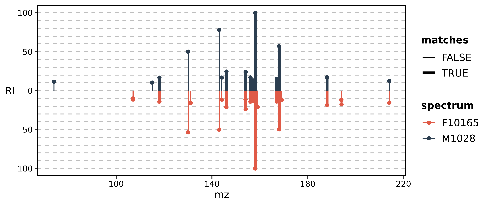{width=100%}

The function `h_map_MSMS_comparison()` draws heatmaps to visually compare ppm errors and RI differences between feature and metabolite spectra:

```{r, eval=FALSE}
h_map_MSMS_comparison(mL_norm_bio, metab_id = "L1660", feature_id = "F10165")
```

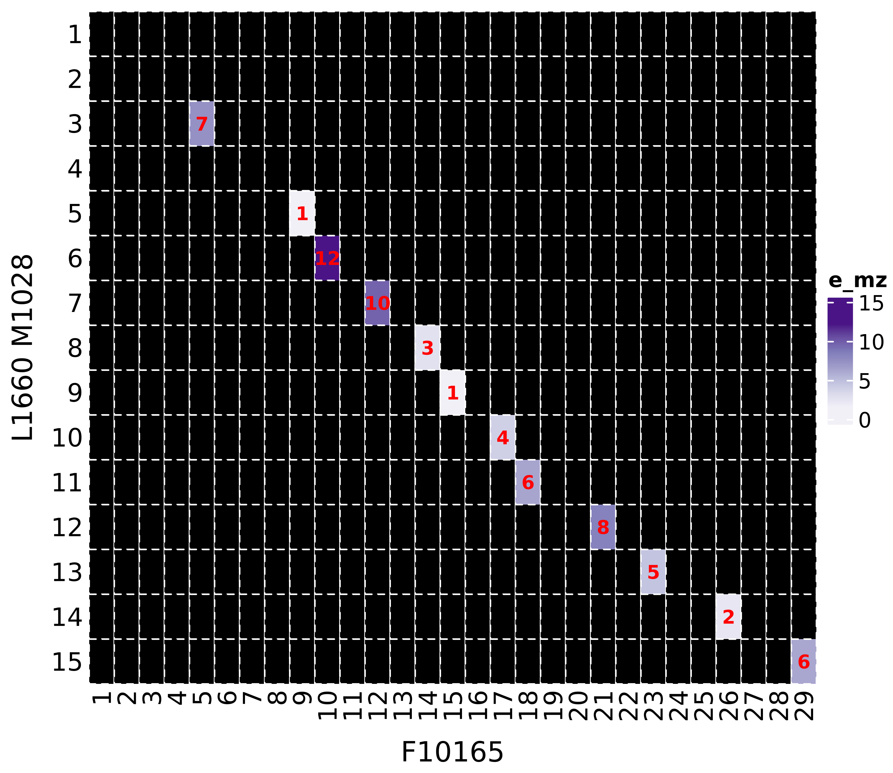{width=49%} 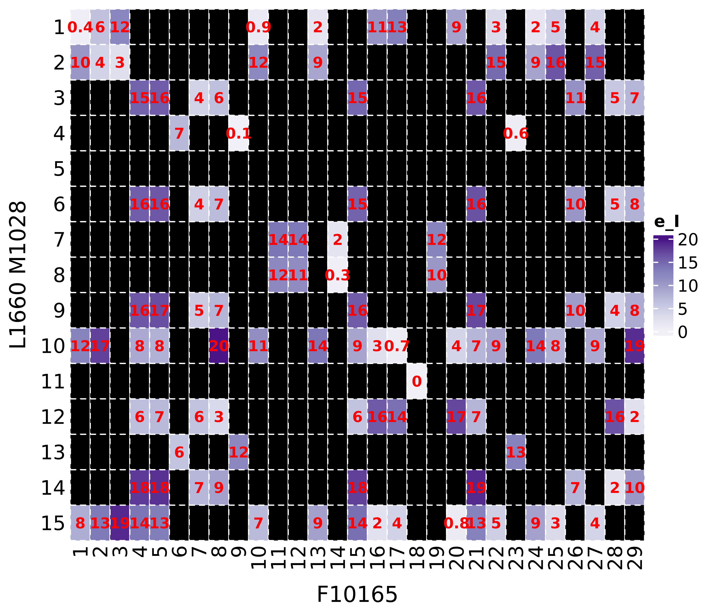{width=49%}

# Metabolite abundance visualization

The function `metab_boxplot()` draws boxplots of feature abundances grouped by the levels of a given factor:

```{r, eval=FALSE}
 metab_boxplot(mL.norm.bio, feature = "F3957")
```

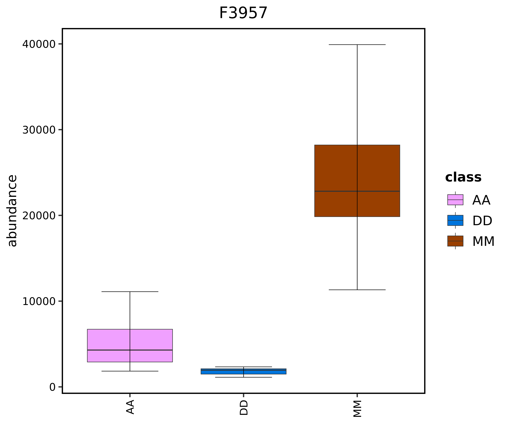{width=70%} 

The function `h_map()` provides heatmaps based on package ComplexHeatmap [@Gu2016]. Here we show the abundance of the most significant metabolites according to ANOVA test. Note that we set `feature_id = "Name"` which indicates to consider only those features that have a `Name` column in the annotation, that is, have been assigned to a metabolite:

```{r, eval=FALSE}
significant_features <- select_sign_features(mL.norm.bio, test_method="anova", test_value = "q", cutoff_value = 10e-10, feature_id = "Name")
h_map(mL.norm.bio, scale_features=TRUE, features = significant_features, show_column_names=F, data.use = "data_ann")
```

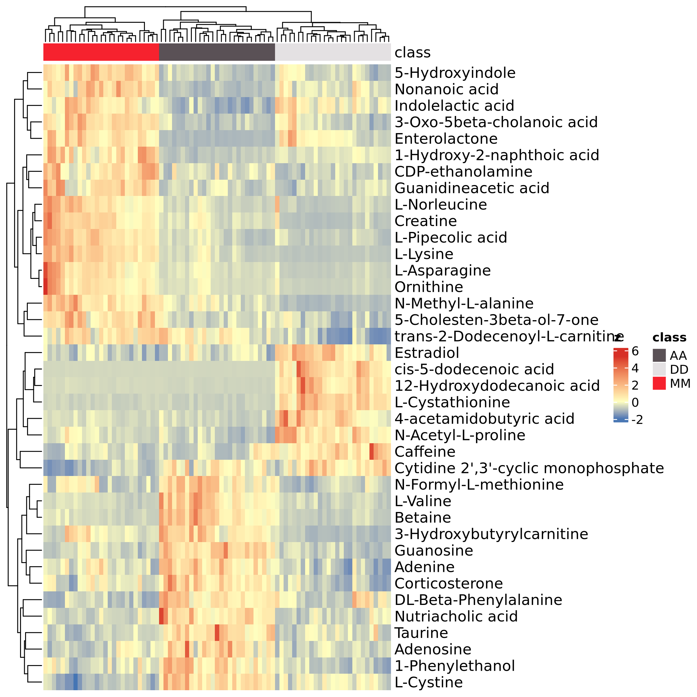{width=99%}

# Exporting metabolite annotation and stastical analysis results

The function `merge_stats_w_features()` joins the results of metabolite annotation and statistical analysis, and produces a list of data frames and an xlsx file creating with the following items/sheets:

- `metab_stat`: full table with feature annotation and statistical analysis results;

- `metab_stat_feat`: same as `metab_stat`, with the addition of feature intensities;

- `metab_stat_feat_known`: same as `metab_stat_feat`, but restricted to features with an assigned compound;

- `metab_stat_feat_sig`: same as `metab_stat_feat`, but only for statistically significant features;

- `metab_stat_feat_known_sig`: same as `metab_stat_feat`, but only for statistically significant features with an assigned compound.

```{r, eval=FALSE}
metab_stats <- merge_stats_w_features(mRList = mL.norm.bio, test_method = "anova", test_value = "q", cutoff_value = 0.05, dirout = dir_out)
```

# Pathway analysis

margheRita implements both Over Representation Analysis (ORA) and Metabolite Set Enrichment Analysis (MSEA), based on clusterProfiler [@Yu2012] over BioCyc, KEGG and Reactome pathway databases. These analyses can be run by means of function `pathway_analysis()`.

In case of ORA the minimum requirements are the vector of PubChemCID to be tested and the reference universe of all PubChemCIDs in the dataset. In the following example we extract the PubChemCID of the most significant features according to anova and consider all the PubChemCID found in the dataset as reference universe:

```{r, eval=FALSE}
significant_features <- select_sign_features(mL.norm.bio, test_method="anova", test_value = "q", cutoff_value = 10e-10, feature_id = "PubChemCID", split_by_semicolon = T)
universe <-  select_sign_features(mL.norm.bio, test_method="anova", test_value = "q", feature_id = "PubChemCID", split_by_semicolon = T)
pa_res <- pathway_analysis(significant_features, type = "ora", universe = universe)

loading pathway data...
preprocessing pathway data...
reducing pathway data to the given universe...
ORA...
```
Note that we set the argument `split_by_semicolon=TRUE` because the statistical analysis was conducted at feature level and we can have a $(1,n)$ mapping between features and metaboltes, which yields multiple semicolon-separated PubChemCIDs for the same feature.

In case of MSEA, we obtain a ranked vector of scores (`values = TRUE`) for all PubChemCIDs in the dataset, in decreasing order of importance:

```{r, eval=FALSE}
ranked_vector <- select_sign_features(mL_norm_bio, test_method="anova", test_value = "q", cutoff_value = Inf, feature_id = "PubChemCID", values = TRUE, split_by_semicolon = T)
ranked_vector <- sort(-log10(ranked_vector), decreasing = T)
msea_res <- pathway_analysis(in_list = ranked_vector, type = "msea")
```

In both cases (ORA and MSEA), the result is a list that contains:

- `term_annotation`: a table with pathway descriptions;
```{r, eval=FALSE}

head(pa_res$term_annotation[, 1:7])
      bs_id source source_acc                              name    type                   tax_id_bs tax_id
66389 82928   KEGG   hsa00030         Pentose phosphate pathway pathway organism-specific biosystem   9606
66392 82931   KEGG   hsa00052              Galactose metabolism pathway organism-specific biosystem   9606
66393 82932   KEGG   hsa00053 Ascorbate and aldarate metabolism pathway organism-specific biosystem   9606
66394 82933   KEGG   hsa00061           Fatty acid biosynthesis pathway organism-specific biosystem   9606
66396 82935   KEGG   hsa00071            Fatty acid degradation pathway organism-specific biosystem   9606
66398 82937   KEGG   hsa00100              Steroid biosynthesis pathway organism-specific biosystem   9606
```

- `res`: an object of class "enrichResult" (ORA) or "gseaResult" (MSEA), which can be used to obtain various visualizations through clusterProfiler functions.

```{r, eval=FALSE}
class(pa_res$res)
[1] "enrichResult"
attr(,"package")
[1] "enrichit"
> class(msea_res$res)
[1] "gseaResult"
attr(,"package")
[1] "enrichit"
```

The packages [clusterProfiler](https://bioconductor.org/packages/release/bioc/html/clusterProfiler.html) [@Yu2012] and [enrichplot](https://bioconductor.org/packages/release/bioc/html/enrichplot.html) [@Yu2015] provide various functions to visualize and export enrichment analysis results (note that, since such packages are focused on functional genomics, their terminology mentions genes and gene sets). For example, here we use `barplot()` for ORA results and `enrichplot::dotplot()` for MSEA results. 

```{r, eval=FALSE}
barplot(pa_res$res, showCategory=5)
```

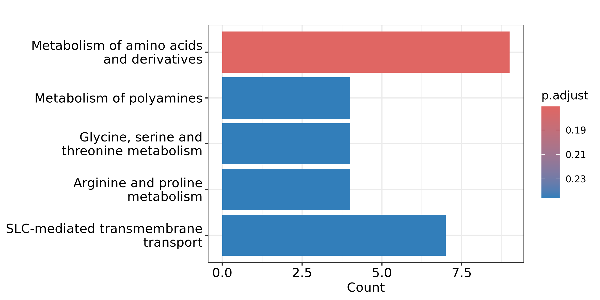{width=99%}

```{r, eval=FALSE}
enrichplot::dotplot(msea_res$res, showCategory = 10, split = ".sign")
```
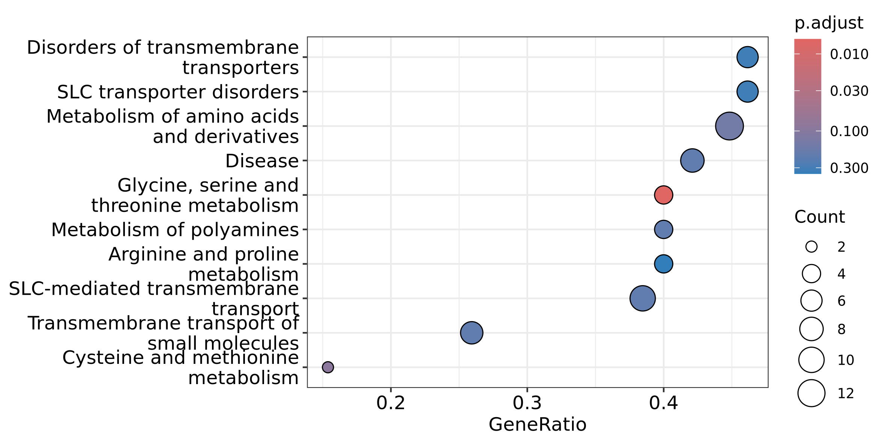{width=99%}


# SummarizedExperiment

To support interoperability with other packages the mRList can be reorganized as a "SummarizedExperiment" object, which is used by "notame" [@Klavus2020] and package "POMA" [@Castellano2021]. 

```{r, eval=FALSE}
se <- as.SummarizedExperiment(mL)
se
class: SummarizedExperiment 
dim: 33554 316 
metadata(0):
assays(1): ''
rownames(33554): F1 F3 ... F42636 F42638
rowData names(8): Feature_ID MSDialName ... MS_MS_spectrum Split
colnames(316): x001_Blank_1_norm_RP_short_SWATH_pos x002_Blank_1_norm_RP_short_SWATH_pos ... x309_QC_norm_55_RP_short_SWATH_pos
  x313_QC_norm_56_RP_short_SWATH_pos
colData names(7): Sample_ID Injection_order ... biological_rep QC
```

# References
